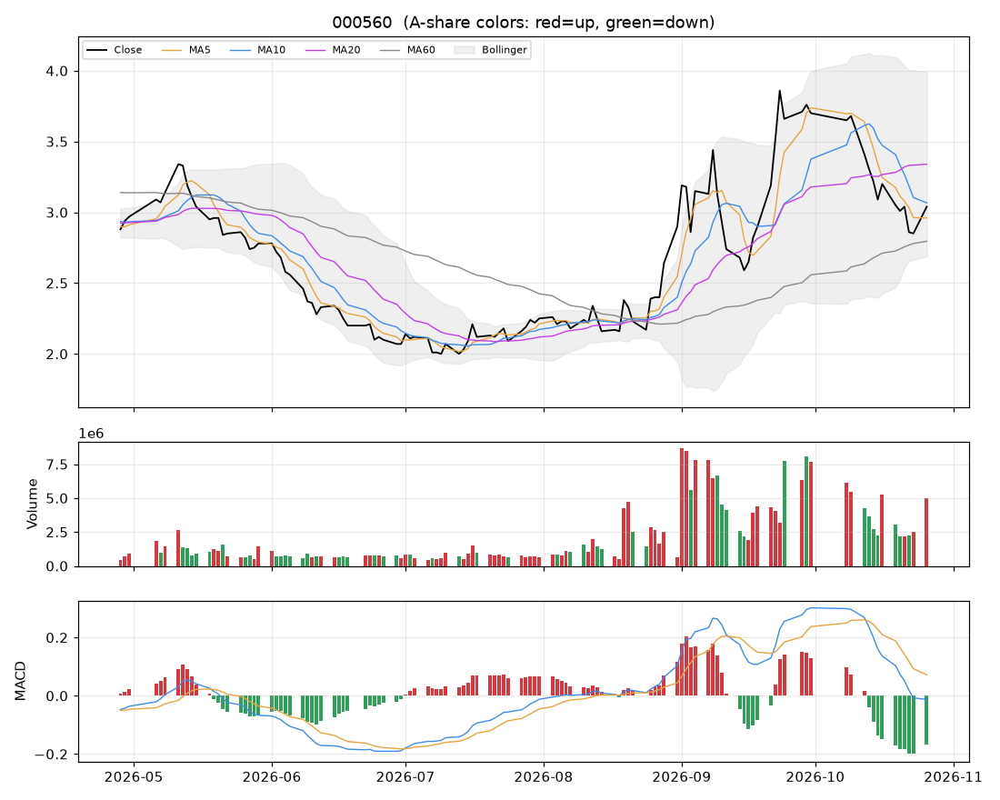

# 个股分析:我爱我家(000560)  2026-10-26

> 规则化分析,仅供个人研究参考,不构成投资建议;不覆盖基本面/公告/解禁/减持等事件,操作前请自行核对。

数据来源:实时拉取(新浪);行业:未知;最新价 **3.04**(+6.67%)

## 结论速览

**综合评分 36/100 → 倾向「偏空」**

| 维度 | 得分 | 权重 | 加减分项/说明 |
|---|---|---|---|
| 模型(全市场分位) | 4 | 35% | 第740/758名 |
| 趋势(均线/MACD/RSI) | 38 | 25% | 收盘<MA20(-10)、收盘>MA60(+10)、MA20向上(+8)、MA5<MA10<MA20空头排列(-10)、DIF<DEA(-6)、DIF在零轴下(-4) |
| 量价 | 72 | 20% | 价涨量增(+12)、近10日上涨日量能占优(+10) |
| 环境(板块/大盘/相对强弱) | 55 | 20% | 市场情绪46(-1.6)、20日相对沪深300 +13.8%(+6.9) |

## 一、模型视角

- 模型分位 **4%**(LightGBM 0% / ICIR线性 10%),在 758 只可交易股票中排第 **740**。目标是预测未来 5 日的截面相对强弱,不是预测涨跌绝对值。

推高得分的因子 Top5:

| 因子 | 该股标准分(z) | LightGBM SHAP 贡献 |
|---|---|---|
| 20日换手 | +3.13 | +0.0134 |
| 1日反转 | -2.88 | +0.0041 |
| 5日动量 | -0.08 | +0.0012 |
| 开盘跳空 | +1.38 | +0.0009 |
| OBV斜率 | +0.36 | +0.0007 |

拉低得分的因子 Top5:

| 因子 | 该股标准分(z) | LightGBM SHAP 贡献 |
|---|---|---|
| ATR波幅 | +1.96 | -0.0231 |
| 20日波动率 | +2.71 | -0.0157 |
| 换手放大 | -1.98 | -0.0154 |
| 20日最大单日涨幅 | +2.08 | -0.0141 |
| 量比 | +2.62 | -0.0087 |

说明:z 为该因子在全市场(行业中性后)的标准分;SHAP 为该因子对模型打分的边际贡献,正值=推高。

## 二、技术面

| 指标 | 数值 | 解读 |
|---|---|---|
| 均线 MA5/10/20/60 | 2.96 / 3.07 / 3.34 / 2.80 | 空头排列(短期弱) |
| MA20 斜率(5日) | +1.77% | 向上 |
| 收盘 vs MA20 乖离 | -9.0% | 正常区间 |
| MACD DIF/DEA/柱 | -0.013 / 0.072 / -0.169 | 零轴下、DIF在DEA下方 |
| KDJ K/D/J | 22 / 16 / 34 | 金叉 |
| RSI14 | 48 | 中性 |
| 布林 %B / 带宽分位 | 0.27 / 72% | 带内运行 |
| ATR14 | 0.25(8.3%) | 日均波幅,用于止损/目标 |
| 今日K线 | +6.67% | 无特殊形态 |

## 三、量价分析

| 指标 | 数值 | 解读 |
|---|---|---|
| 量比(今/前5日均) | 2.04 | 价涨量增(健康) |
| 成交额 / 20日均 | 0.98x | 正常 |
| 换手率120日分位 | 88% | 交投活跃 |
| 近10日 上涨日/下跌日均量 | 1.57 | 上涨放量占优 |
| OBV 与价格(20日) | 价格分位22% / OBV分位40% | 无明显背离 |
| 资金代理 5日/20日 | +0.07 / +0.04 | 中性(CLV估算,非真实主力资金) |
| 收盘 vs 20日量加权均价 | -11.6% | 在成本区下方 |
| 特殊量价信号 | 无 |  |

## 四、相对强弱与环境

|  | 20日 | 60日 |
|---|---|---|
| 该股 | +4.83% | +45.45% |
| 沪深300 | -8.96% | -11.74% |

- 板块信息不可用(不在股票池或行业未知)
- 大盘:情绪温度 46(震荡/中性);整体仓位参考 30%~40%

## 五、该股历史同类信号表现(近3年,持有5日,T+1开盘买入)

| 信号 | 当前触发 | 次数 | 平均 | 中位数 | 胜率 | 样本 |
|---|---|---|---|---|---|---|
| MACD金叉 | 否 | 24 | +0.79% | +2.68% | 62% | 可参考 |
| 放量突破20日高 | 否 | 14 | -0.13% | +1.44% | 57% | 可参考 |
| 缩量回踩MA20 | 否 | 21 | +0.81% | -0.31% | 48% | 可参考 |
| RSI超卖(<30) | 否 | 9 | -2.02% | -1.90% | 33% | 不足(<10) |
| 布林下轨反弹 | 否 | 10 | -0.12% | -2.73% | 30% | 可参考 |
| 均线刚形成多头排列 | 否 | 28 | +3.05% | +2.26% | 61% | 可参考 |
| 放量跌破20日低 | 否 | 6 | +0.33% | -2.66% | 33% | 不足(<10) |

该股无条件持有5日平均收益 +0.82%。次数<10 的统计基本不可靠;信号过去有效不代表以后有效,仅作参考。

## 六、操作参考

**当前倾向:偏空(综合 36)**

### 价位(基于 ATR 与近期结构)

| 项目 | 数值 |
|---|---|
| 最新价 | 3.04 |
| 下方支撑 | 2.86 |
| 上方压力 1 / 2 | 3.44 / 4.10 |
| 建议止损价 | 2.79(距现价 8.3%) |
| 目标 1 / 目标 2 | 3.44 / 4.10 |
| 盈亏比(到目标1) | 1.6 |
| 回踩介入区 | - |

### 空仓者

- 回避,不抄底。等重新站上 MA20(3.34)并放量后再评估。

### 已持仓者

- 反弹至 MA5/MA10(2.96/3.07)或压力位(3.44)时减仓/清仓;止损价不可下移。

### 仓位

- 单票仓位上限约 **0%** 总资金(= min(档位上限 0%, 单笔风险1%÷止损幅度8.3%=12%) × 市场情绪系数 0.77)
- 分批建仓,首笔不超过上限的一半;亏损时不加仓摊平。

### 失效条件(出现任一条,以上判断作废)

- 收盘跌破止损价 2.79
- 放量(量比>1.5)跌破20日低点 2.71
- 所属板块转弱(强度分掉出前50%)且个股缩量冲高回落
- 出现公告类利空/业绩预亏/减持/解禁等基本面事件(本程序未覆盖,需自行核对)

### 交易规则提醒

- T+1:今日买入明日才能卖;涨跌停幅度 ±10%;止损位只能在下一交易日起执行,跳空时成交价会更差。
- 本分析不含基本面、业绩预告、公告、解禁/减持、融资融券与龙虎榜,请在下单前自行核对。
