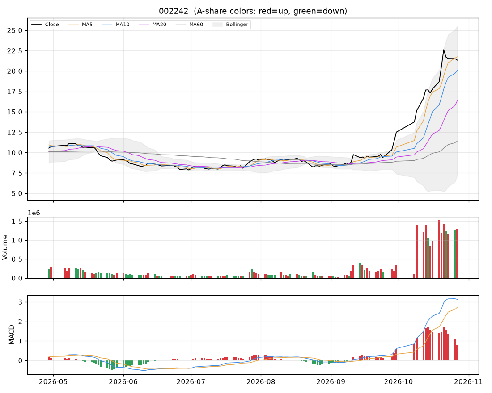

# 个股分析:九阳股份(002242)  2026-10-27

> 规则化分析,仅供个人研究参考,不构成投资建议;不覆盖基本面/公告/解禁/减持等事件,操作前请自行核对。

数据来源:实时拉取(新浪);行业:家电行业;最新价 **21.34**(-0.84%)

## 结论速览

**综合评分 65/100 → 倾向「中性偏多」**

| 维度 | 得分 | 权重 | 加减分项/说明 |
|---|---|---|---|
| 模型(全市场分位) | 无 | 35% | 关键数据缺失 |
| 趋势(均线/MACD/RSI) | 82 | 25% | 收盘>MA20(+10)、收盘>MA60(+10)、MA20向上(+8)、MA5>MA10>MA20多头排列(+10)、DIF>DEA(+6)、DIF在零轴上(+4)、RSI>80过热(-8)、乖离MA20>15%(-8) |
| 量价 | 56 | 20% | 5日资金代理净流入(+6) |
| 环境(板块/大盘/相对强弱) | 54 | 20% | 所属板块强度65(+7.6)、板块拥挤度>90%(-5)、市场情绪28(-9)、20日相对沪深300 +133.6%(+10) |

- ⚠ 短线过热(乖离MA20 +30.6%,RSI 82):不追高,等回踩

## 一、模型视角

- 模型未对该股打分:关键数据缺失。
- 综合评分已自动把模型权重分摊给其余三个维度。

## 二、技术面

| 指标 | 数值 | 解读 |
|---|---|---|
| 均线 MA5/10/20/60 | 21.74 / 20.08 / 16.34 / 11.40 | 多头排列(短期强) |
| MA20 斜率(5日) | +23.18% | 向上 |
| 收盘 vs MA20 乖离 | +30.6% | 乖离过大(>15%),回落风险 |
| MACD DIF/DEA/柱 | 3.126 / 2.721 / 0.809 | 零轴上、DIF在DEA上方 |
| KDJ K/D/J | 86 / 89 / 78 | 中性 |
| RSI14 | 82 | 过热(>80) |
| 布林 %B / 带宽分位 | 0.77 / 94% | 带内运行、带宽扩张(波动放大) |
| ATR14 | 1.79(8.4%) | 日均波幅,用于止损/目标 |
| 今日K线 | -0.84% | 长上影(上方抛压)、十字星(多空僵持) |

## 三、量价分析

| 指标 | 数值 | 解读 |
|---|---|---|
| 量比(今/前5日均) | 1.03 | 量价关系平淡 |
| 成交额 / 20日均 | 1.75x | 放量 |
| 换手率120日分位 | 97% | 交投活跃 |
| 近10日 上涨日/下跌日均量 | 1.07 | 均衡 |
| OBV 与价格(20日) | 价格分位80% / OBV分位60% | 无明显背离 |
| 资金代理 5日/20日 | +0.32 / +0.51 | 偏流入 |
| 收盘 vs 20日量加权均价 | +14.9% | 在成本区上方 |
| 特殊量价信号 | 无 |  |

## 四、相对强弱与环境

|  | 20日 | 60日 |
|---|---|---|
| 该股 | +124.63% | +140.32% |
| 沪深300 | -8.96% | -11.74% |
| 所属板块(家电行业,等权) | -3.47% | - |

- 板块强度分 65,排第 11/49;今日 -1.26%,5日 -3.57%,拥挤度 100%,上涨占比 7%
- 板块归因:板块等权下跌1.26%;缩量(0.7倍);普跌(上涨占比仅7%);5日资金代理持续净流入;成交占比处于近120日高位,拥挤度高,警惕分歧。领跌:格力电器(-1.6%)、美的集团(-0.5%)、海信家电(-3.5%)
- 大盘:情绪温度 28(偏冷);整体仓位参考 10%~20%

## 五、该股历史同类信号表现(近3年,持有2日,T+1开盘买入)

| 信号 | 当前触发 | 次数 | 平均 | 中位数 | 胜率 | 样本 |
|---|---|---|---|---|---|---|
| MACD金叉 | 否 | 24 | +0.98% | +0.32% | 58% | 可参考 |
| 放量突破20日高 | 否 | 17 | +0.78% | -1.45% | 41% | 可参考 |
| 缩量回踩MA20 | 否 | 43 | -0.34% | +0.09% | 51% | 可参考 |
| RSI超卖(<30) | 否 | 25 | +0.84% | +0.74% | 64% | 可参考 |
| 布林下轨反弹 | 否 | 23 | +0.60% | +0.72% | 61% | 可参考 |
| 均线刚形成多头排列 | 否 | 29 | -1.04% | -0.32% | 38% | 可参考 |
| 放量跌破20日低 | 否 | 9 | -0.39% | -1.60% | 44% | 不足(<10) |

该股无条件持有2日平均收益 +0.19%。次数<10 的统计基本不可靠;信号过去有效不代表以后有效,仅作参考。

## 六、操作参考

**当前倾向:中性偏多(综合 65)**

### 价位(基于 ATR 与近期结构)

| 项目 | 数值 |
|---|---|
| 最新价 | 21.34 |
| 下方支撑 | 16.34 |
| 上方压力 1 / 2 | 22.62 |
| 建议止损价 | 18.65(距现价 12.6%) |
| 目标 1 / 目标 2 | 24.93 / 28.51 |
| 盈亏比(到目标1) | 1.3 |
| 回踩介入区 | 16.26~20.18 |

- ⚠ 到目标1的盈亏比仅 1.3(<1.5),性价比一般,宁可等更好的位置。

### 空仓者

- 短线过热,不追高:等回踩 16.26~20.18 缩量企稳后再考虑,此时的突破信号不跟。

### 已持仓者

- 可持有但不加仓;收盘跌破 MA20 且放量,或触及止损价,先减仓一半。
- 反弹到 24.93 附近若放量滞涨(上影线变长),逢高减仓。
- 乖离/RSI 偏高,可分批止盈一部分,剩余用 MA10 做移动止盈。

### 仓位

- 单票仓位上限约 **4%** 总资金(= min(档位上限 15%, 单笔风险1%÷止损幅度12.6%=8%) × 市场情绪系数 0.46)
- 分批建仓,首笔不超过上限的一半;亏损时不加仓摊平。

### 失效条件(出现任一条,以上判断作废)

- 收盘跌破止损价 18.65
- 放量(量比>1.5)跌破20日低点 9.28
- 所属板块转弱(强度分掉出前50%)且个股缩量冲高回落
- 出现公告类利空/业绩预亏/减持/解禁等基本面事件(本程序未覆盖,需自行核对)

### 交易规则提醒

- T+1:今日买入明日才能卖;涨跌停幅度 ±10%;止损位只能在下一交易日起执行,跳空时成交价会更差。
- 本分析不含基本面、业绩预告、公告、解禁/减持、融资融券与龙虎榜,请在下单前自行核对。
