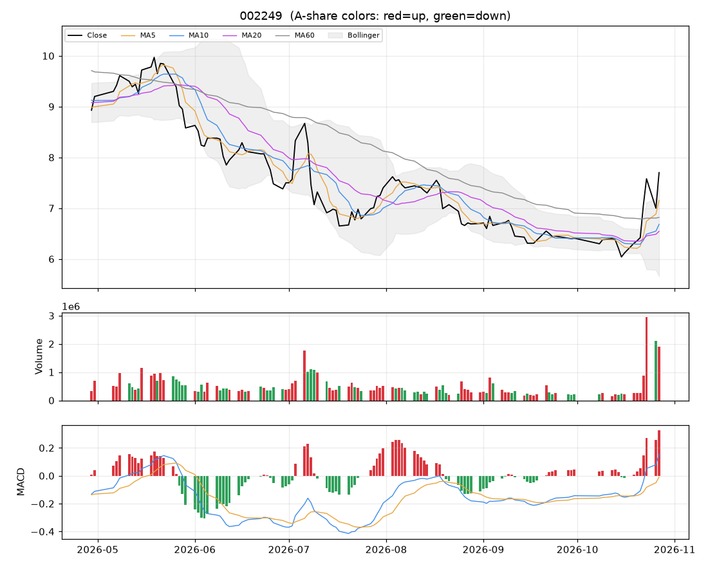

# 个股分析:大洋电机(002249)  2026-10-27

> 规则化分析,仅供个人研究参考,不构成投资建议;不覆盖基本面/公告/解禁/减持等事件,操作前请自行核对。

数据来源:实时拉取(新浪);行业:电器行业;最新价 **7.70**(+10.00%)

## 结论速览

**综合评分 71/100 → 倾向「偏多」**

| 维度 | 得分 | 权重 | 加减分项/说明 |
|---|---|---|---|
| 模型(全市场分位) | 无 | 35% | 关键数据缺失 |
| 趋势(均线/MACD/RSI) | 90 | 25% | 收盘>MA20(+10)、收盘>MA60(+10)、MA20向上(+8)、MA5>MA10>MA20多头排列(+10)、DIF>DEA(+6)、DIF在零轴上(+4)、乖离MA20>15%(-8) |
| 量价 | 68 | 20% | 价涨量增(+12)、5日资金代理净流入(+6) |
| 环境(板块/大盘/相对强弱) | 51 | 20% | 所属板块强度51(+0.3)、市场情绪27(-9.3)、20日相对沪深300 +26.5%(+10) |

- ⚠ 今日涨停:次日开盘大概率高开,难以按理想价买入,不追;已持仓者看次日是否放量炸板
- ⚠ 短线过热(乖离MA20 +17.7%,RSI 68):不追高,等回踩

## 一、模型视角

- 模型未对该股打分:关键数据缺失。
- 综合评分已自动把模型权重分摊给其余三个维度。

## 二、技术面

| 指标 | 数值 | 解读 |
|---|---|---|
| 均线 MA5/10/20/60 | 7.15 / 6.68 / 6.54 / 6.82 | 多头排列(短期强) |
| MA20 斜率(5日) | +3.08% | 向上 |
| 收盘 vs MA20 乖离 | +17.7% | 乖离过大(>15%),回落风险 |
| MACD DIF/DEA/柱 | 0.155 / -0.009 / 0.328 | 零轴上、DIF在DEA上方 |
| KDJ K/D/J | 80 / 70 / 100 | 超买(J>100) |
| RSI14 | 68 | 中性 |
| 布林 %B / 带宽分位 | 1.15 / 84% | 贴近上轨、带宽扩张(波动放大) |
| ATR14 | 0.34(4.4%) | 日均波幅,用于止损/目标 |
| 今日K线 | +10.00% | 大阳线(收近高位) |

## 三、量价分析

| 指标 | 数值 | 解读 |
|---|---|---|
| 量比(今/前5日均) | 1.47 | 价涨量增(健康) |
| 成交额 / 20日均 | 3.53x | 放量 |
| 换手率120日分位 | 98% | 交投活跃 |
| 近10日 上涨日/下跌日均量 | 1.14 | 均衡 |
| OBV 与价格(20日) | 价格分位100% / OBV分位95% | 无明显背离 |
| 资金代理 5日/20日 | +0.43 / +0.28 | 偏流入 |
| 收盘 vs 20日量加权均价 | +9.1% | 在成本区上方 |
| 特殊量价信号 | 无 |  |

## 四、相对强弱与环境

|  | 20日 | 60日 |
|---|---|---|
| 该股 | +17.56% | +10.16% |
| 沪深300 | -8.96% | -11.74% |
| 所属板块(电器行业,等权) | -11.69% | - |

- 板块强度分 51,排第 24/49;今日 -2.04%,5日 -2.79%,拥挤度 1%,上涨占比 2%
- 板块归因:板块等权下跌2.04%;缩量(0.1倍);普跌(上涨占比仅2%);5日资金代理净流出。领跌:东方电缆(-1.9%)、弘讯科技(-4.8%)、中电电机(-2.2%)
- 大盘:情绪温度 27(偏冷);整体仓位参考 10%~20%

## 五、该股历史同类信号表现(近3年,持有2日,T+1开盘买入)

| 信号 | 当前触发 | 次数 | 平均 | 中位数 | 胜率 | 样本 |
|---|---|---|---|---|---|---|
| MACD金叉 | 否 | 29 | +0.48% | +0.56% | 59% | 可参考 |
| 放量突破20日高 | 否 | 19 | +0.89% | +1.03% | 53% | 可参考 |
| 缩量回踩MA20 | 否 | 38 | +1.08% | +1.11% | 58% | 可参考 |
| RSI超卖(<30) | 否 | 16 | +1.37% | +1.08% | 75% | 可参考 |
| 布林下轨反弹 | 否 | 24 | +0.83% | +1.02% | 62% | 可参考 |
| 均线刚形成多头排列 | 否 | 30 | +0.64% | -0.21% | 43% | 可参考 |
| 放量跌破20日低 | 否 | 3 | +2.67% | +2.50% | 100% | 不足(<10) |

该股无条件持有2日平均收益 +0.27%。次数<10 的统计基本不可靠;信号过去有效不代表以后有效,仅作参考。

## 六、操作参考

**当前倾向:偏多(综合 71)**

### 价位(基于 ATR 与近期结构)

| 项目 | 数值 |
|---|---|
| 最新价 | 7.70 |
| 下方支撑 | 7.33 |
| 上方压力 1 / 2 | 7.75 |
| 建议止损价 | 7.26(距现价 5.8%) |
| 目标 1 / 目标 2 | 8.37 / 9.05 |
| 盈亏比(到目标1) | 1.5 |
| 回踩介入区 | 6.51~6.71 |

### 空仓者

- 今日涨停,次日开盘价不可控,不追。若次日高开回落、缩量企稳在 6.51~6.71 再评估;连续一字板则根本买不到。

### 已持仓者

- 继续持有;止损位上移到下方给出的止损价,不随意下调。
- 到第一目标 8.37 先减 1/3~1/2,剩余用 MA10 或「最高价-2×ATR」做移动止盈。
- 次日若高开后放量炸板/冲高回落,先减 1/3~1/2;封单稳固可继续持有,止损上移到今日最低价 6.84 附近。

### 仓位

- 单票仓位上限约 **8%** 总资金(= min(档位上限 25%, 单笔风险1%÷止损幅度5.8%=17%) × 市场情绪系数 0.45)。今日涨/跌停,新建仓位建议为 0,上面数字仅供后续参考
- 分批建仓,首笔不超过上限的一半;亏损时不加仓摊平。

### 失效条件(出现任一条,以上判断作废)

- 收盘跌破止损价 7.26
- 放量(量比>1.5)跌破20日低点 6.04
- 所属板块转弱(强度分掉出前50%)且个股缩量冲高回落
- 出现公告类利空/业绩预亏/减持/解禁等基本面事件(本程序未覆盖,需自行核对)

### 交易规则提醒

- T+1:今日买入明日才能卖;涨跌停幅度 ±10%;止损位只能在下一交易日起执行,跳空时成交价会更差。
- 本分析不含基本面、业绩预告、公告、解禁/减持、融资融券与龙虎榜,请在下单前自行核对。
