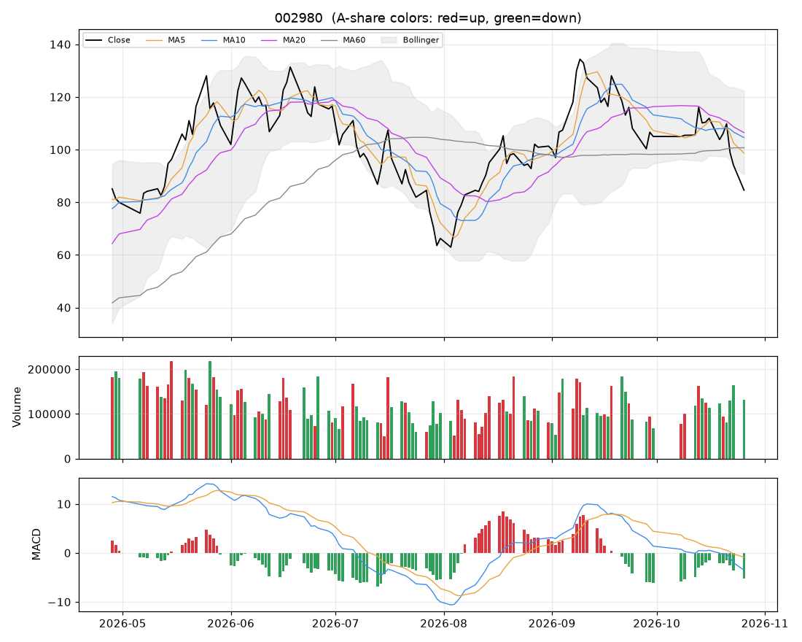

# 个股分析:华盛昌(002980)  2026-10-26

> 规则化分析,仅供个人研究参考,不构成投资建议;不覆盖基本面/公告/解禁/减持等事件,操作前请自行核对。

数据来源:实时拉取(新浪);行业:未知;最新价 **84.59**(-10.00%)

## 结论速览

**综合评分 32/100 → 倾向「偏空」**

| 维度 | 得分 | 权重 | 加减分项/说明 |
|---|---|---|---|
| 模型(全市场分位) | 43 | 35% | 第452/758名 |
| 趋势(均线/MACD/RSI) | 2 | 25% | 收盘<MA20(-10)、收盘<MA60(-10)、MA20向下(-8)、MA5<MA10<MA20空头排列(-10)、DIF<DEA(-6)、DIF在零轴下(-4) |
| 量价 | 44 | 20% | 5日资金代理净流出(-6) |
| 环境(板块/大盘/相对强弱) | 38 | 20% | 市场情绪46(-1.6)、20日相对沪深300 -25.0%(-10) |

- ⚠ 价格在MA60下方且MA20向下,综合分封顶 52(下降趋势中不抄底)
- ⚠ 今日跌停:不抄底;已持仓者次日若反抽无力,以控制风险为先

## 一、模型视角

- 模型分位 **43%**(LightGBM 39% / ICIR线性 49%),在 758 只可交易股票中排第 **452**。目标是预测未来 5 日的截面相对强弱,不是预测涨跌绝对值。

推高得分的因子 Top5:

| 因子 | 该股标准分(z) | LightGBM SHAP 贡献 |
|---|---|---|
| 20日换手 | +3.13 | +0.0291 |
| 20日动量 | -2.13 | +0.0196 |
| 20日最大单日涨幅 | +2.06 | +0.0141 |
| 5日资金代理 | -1.90 | +0.0076 |
| 60日区间位置 | -0.06 | +0.0057 |

拉低得分的因子 Top5:

| 因子 | 该股标准分(z) | LightGBM SHAP 贡献 |
|---|---|---|
| 开盘跳空 | -3.68 | -0.0247 |
| 1日反转 | +3.53 | -0.0127 |
| Amihud非流动性 | -0.55 | -0.0111 |
| ATR波幅 | +3.19 | -0.0085 |
| 5日动量 | -3.33 | -0.0083 |

说明:z 为该因子在全市场(行业中性后)的标准分;SHAP 为该因子对模型打分的边际贡献,正值=推高。

## 二、技术面

| 指标 | 数值 | 解读 |
|---|---|---|
| 均线 MA5/10/20/60 | 98.66 / 104.56 / 106.45 / 100.70 | 空头排列(短期弱) |
| MA20 斜率(5日) | -5.00% | 向下 |
| 收盘 vs MA20 乖离 | -20.5% | 正常区间 |
| MACD DIF/DEA/柱 | -3.525 / -0.877 / -5.296 | 零轴下、DIF在DEA下方 |
| KDJ K/D/J | 19 / 33 / -9 | 超卖(J<0) |
| RSI14 | 34 | 中性 |
| 布林 %B / 带宽分位 | -0.19 / 22% | 贴近下轨 |
| ATR14 | 8.89(10.5%) | 日均波幅,用于止损/目标 |
| 今日K线 | -10.00% | 大阴线(收近低位) |

## 三、量价分析

| 指标 | 数值 | 解读 |
|---|---|---|
| 量比(今/前5日均) | 1.11 | 量价关系平淡 |
| 成交额 / 20日均 | 0.91x | 正常 |
| 换手率120日分位 | 66% | 正常 |
| 近10日 上涨日/下跌日均量 | 0.84 | 均衡 |
| OBV 与价格(20日) | 价格分位5% / OBV分位30% | 无明显背离 |
| 资金代理 5日/20日 | -0.34 / -0.24 | 偏流出 |
| 收盘 vs 20日量加权均价 | -20.8% | 在成本区下方 |
| 特殊量价信号 | 无 |  |

## 四、相对强弱与环境

|  | 20日 | 60日 |
|---|---|---|
| 该股 | -33.93% | +3.28% |
| 沪深300 | -8.96% | -11.74% |

- 板块信息不可用(不在股票池或行业未知)
- 大盘:情绪温度 46(震荡/中性);整体仓位参考 30%~40%

## 五、该股历史同类信号表现(近3年,持有5日,T+1开盘买入)

| 信号 | 当前触发 | 次数 | 平均 | 中位数 | 胜率 | 样本 |
|---|---|---|---|---|---|---|
| MACD金叉 | 否 | 22 | +2.70% | +1.85% | 59% | 可参考 |
| 放量突破20日高 | 否 | 13 | +5.04% | +5.15% | 62% | 可参考 |
| 缩量回踩MA20 | 否 | 18 | -0.92% | -0.21% | 50% | 可参考 |
| RSI超卖(<30) | 否 | 5 | +1.94% | +1.44% | 60% | 不足(<10) |
| 布林下轨反弹 | 否 | 18 | +0.87% | -0.07% | 50% | 可参考 |
| 均线刚形成多头排列 | 否 | 25 | +3.16% | +1.06% | 56% | 可参考 |
| 放量跌破20日低 | 否 | 6 | +4.88% | +5.78% | 67% | 不足(<10) |

该股无条件持有5日平均收益 +1.45%。次数<10 的统计基本不可靠;信号过去有效不代表以后有效,仅作参考。

## 六、操作参考

**当前倾向:偏空(综合 32)**

### 价位(基于 ATR 与近期结构)

| 项目 | 数值 |
|---|---|
| 最新价 | 84.59 |
| 下方支撑 | 62.06 |
| 上方压力 1 / 2 | 106.45 / 107.79 |
| 建议止损价 | 71.26(距现价 15.8%) |
| 目标 1 / 目标 2 | 106.45 / 120.13 |
| 盈亏比(到目标1) | 1.6 |
| 回踩介入区 | - |

### 空仓者

- 今日跌停,不抄底。至少等跌停打开后企稳、缩量止跌,并重新站上 MA5 再评估。

### 已持仓者

- 反弹至 MA5/MA10(98.66/104.56)或压力位(106.45)时减仓/清仓;止损价不可下移。

### 仓位

- 单票仓位上限约 **0%** 总资金(= min(档位上限 0%, 单笔风险1%÷止损幅度15.8%=6%) × 市场情绪系数 0.77)。今日涨/跌停,新建仓位建议为 0,上面数字仅供后续参考
- 分批建仓,首笔不超过上限的一半;亏损时不加仓摊平。

### 失效条件(出现任一条,以上判断作废)

- 收盘跌破止损价 71.26
- 放量(量比>1.5)跌破20日低点 88.94
- 所属板块转弱(强度分掉出前50%)且个股缩量冲高回落
- 出现公告类利空/业绩预亏/减持/解禁等基本面事件(本程序未覆盖,需自行核对)

### 交易规则提醒

- T+1:今日买入明日才能卖;涨跌停幅度 ±10%;止损位只能在下一交易日起执行,跳空时成交价会更差。
- 本分析不含基本面、业绩预告、公告、解禁/减持、融资融券与龙虎榜,请在下单前自行核对。
