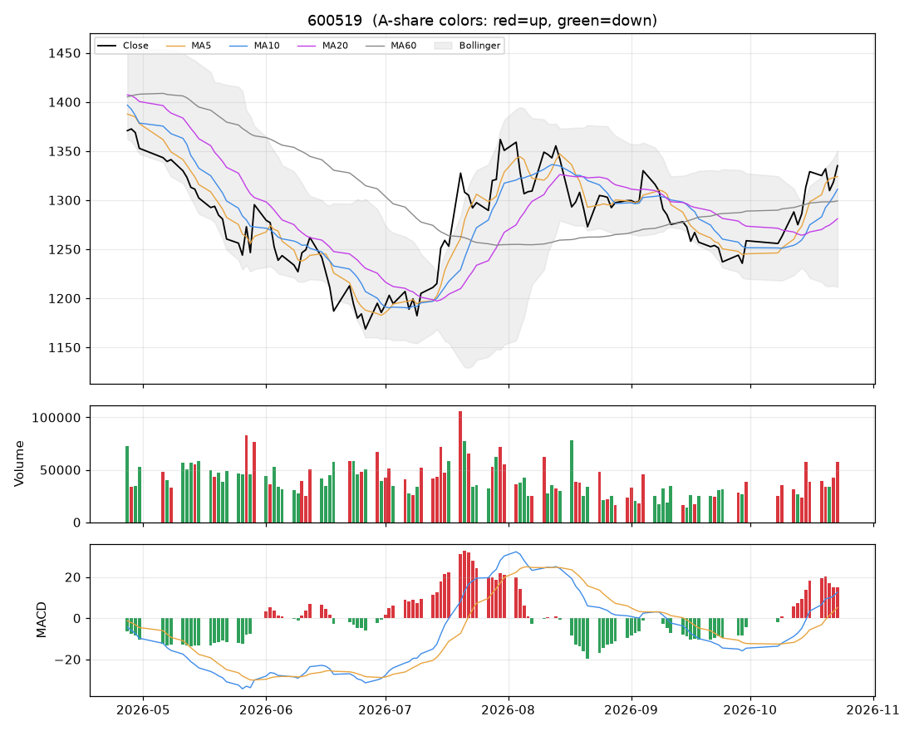

# 个股分析:贵州茅台(600519)  2026-10-23

> 规则化分析,仅供个人研究参考,不构成投资建议;不覆盖基本面/公告/解禁/减持等事件,操作前请自行核对。

数据来源:实时拉取(新浪);行业:酿酒行业;最新价 **1335.00**(+1.25%)

## 结论速览

**综合评分 71/100 → 倾向「偏多」**

| 维度 | 得分 | 权重 | 加减分项/说明 |
|---|---|---|---|
| 模型(全市场分位) | 59 | 35% | 第310/755名 |
| 趋势(均线/MACD/RSI) | 98 | 25% | 收盘>MA20(+10)、收盘>MA60(+10)、MA20向上(+8)、MA5>MA10>MA20多头排列(+10)、DIF>DEA(+6)、DIF在零轴上(+4) |
| 量价 | 68 | 20% | 价涨量增(+12)、5日资金代理净流入(+6) |
| 环境(板块/大盘/相对强弱) | 59 | 20% | 所属板块强度50(+0.1)、板块拥挤度>90%(-5)、市场情绪69(+7.4)、20日相对沪深300 +13.3%(+6.7) |

## 一、模型视角

- 模型分位 **59%**(LightGBM 86% / ICIR线性 19%),在 755 只可交易股票中排第 **310**。目标是预测未来 5 日的截面相对强弱,不是预测涨跌绝对值。

推高得分的因子 Top5:

| 因子 | 该股标准分(z) | LightGBM SHAP 贡献 |
|---|---|---|
| 量价相关 | -0.01 | +0.0078 |
| 60日区间位置 | +1.81 | +0.0066 |
| Amihud非流动性 | -1.45 | +0.0049 |
| 换手放大 | +0.08 | +0.0029 |
| 20日动量 | +0.33 | +0.0021 |

拉低得分的因子 Top5:

| 因子 | 该股标准分(z) | LightGBM SHAP 贡献 |
|---|---|---|
| 量比 | +0.78 | -0.0027 |
| ATR波幅 | -0.49 | -0.0023 |
| MA20乖离 | +0.58 | -0.0012 |
| 5日资金代理 | +1.07 | -0.0011 |
| 60日动量(跳过近5日) | +0.45 | -0.0005 |

说明:z 为该因子在全市场(行业中性后)的标准分;SHAP 为该因子对模型打分的边际贡献,正值=推高。

## 二、技术面

| 指标 | 数值 | 解读 |
|---|---|---|
| 均线 MA5/10/20/60 | 1324.01 / 1311.09 / 1280.97 / 1299.15 | 多头排列(短期强) |
| MA20 斜率(5日) | +1.06% | 向上 |
| 收盘 vs MA20 乖离 | +4.2% | 正常区间 |
| MACD DIF/DEA/柱 | 12.613 / 5.138 / 14.949 | 零轴上、DIF在DEA上方 |
| KDJ K/D/J | 76 / 77 / 75 | 中性 |
| RSI14 | 63 | 中性 |
| 布林 %B / 带宽分位 | 0.89 / 78% | 带内运行 |
| ATR14 | 25.62(1.9%) | 日均波幅,用于止损/目标 |
| 今日K线 | +1.25% | 无特殊形态 |

## 三、量价分析

| 指标 | 数值 | 解读 |
|---|---|---|
| 量比(今/前5日均) | 1.53 | 价涨量增(健康) |
| 成交额 / 20日均 | 1.77x | 放量 |
| 换手率120日分位 | 87% | 交投活跃 |
| 近10日 上涨日/下跌日均量 | 1.23 | 均衡 |
| OBV 与价格(20日) | 价格分位100% / OBV分位100% | 无明显背离 |
| 资金代理 5日/20日 | +0.17 / +0.16 | 偏流入 |
| 收盘 vs 20日量加权均价 | +3.7% | 在成本区上方 |
| 特殊量价信号 | 无 |  |

## 四、相对强弱与环境

|  | 20日 | 60日 |
|---|---|---|
| 该股 | +5.37% | +3.33% |
| 沪深300 | -7.96% | -13.17% |
| 所属板块(酿酒行业,等权) | +1.94% | - |

- 板块强度分 50,排第 21/35;今日 +2.51%,5日 -1.63%,拥挤度 97%,上涨占比 91%
- 板块归因:板块等权上涨2.51%;放量(成交额为20日均值1.8倍);普涨(上涨占比91%);5日资金代理持续净流入;成交占比处于近120日高位,拥挤度高,警惕分歧。领涨:五 粮 液(+3.0%)、贵州茅台(+1.3%)、山西汾酒(+3.6%)
- 大盘:情绪温度 69(偏暖);整体仓位参考 50%~60%

## 五、该股历史同类信号表现(近3年,持有5日,T+1开盘买入)

| 信号 | 当前触发 | 次数 | 平均 | 中位数 | 胜率 | 样本 |
|---|---|---|---|---|---|---|
| MACD金叉 | 否 | 28 | +0.57% | -0.14% | 50% | 可参考 |
| 放量突破20日高 | 否 | 13 | -0.51% | -0.95% | 38% | 可参考 |
| 缩量回踩MA20 | 否 | 25 | -0.29% | -0.43% | 32% | 可参考 |
| RSI超卖(<30) | 否 | 14 | +1.01% | +0.85% | 57% | 可参考 |
| 布林下轨反弹 | 否 | 15 | +1.97% | +0.57% | 53% | 可参考 |
| 均线刚形成多头排列 | 否 | 29 | -1.01% | -0.37% | 38% | 可参考 |
| 放量跌破20日低 | 否 | 9 | +0.11% | +1.57% | 67% | 不足(<10) |

该股无条件持有5日平均收益 -0.05%。次数<10 的统计基本不可靠;信号过去有效不代表以后有效,仅作参考。

## 六、操作参考

**当前倾向:偏多(综合 71)**

### 价位(基于 ATR 与近期结构)

| 项目 | 数值 |
|---|---|
| 最新价 | 1335.00 |
| 下方支撑 | 1300.01 |
| 上方压力 1 / 2 | 1348.60 / 1363.35 |
| 建议止损价 | 1296.57(距现价 2.9%) |
| 目标 1 / 目标 2 | 1386.24 / 1437.47 |
| 盈亏比(到目标1) | 1.3 |
| 回踩介入区 | 1274.57~1317.64 |

- ⚠ 到目标1的盈亏比仅 1.3(<1.5),性价比一般,宁可等更好的位置。

### 空仓者

- 可分批介入:① 回踩 1274.57~1317.64 缩量企稳时买第一笔(不超过计划仓位一半);
- ② 或放量(量比>1.3)有效站上 1348.60 后追加;未放量的突破不跟。

### 已持仓者

- 继续持有;止损位上移到下方给出的止损价,不随意下调。
- 到第一目标 1386.24 先减 1/3~1/2,剩余用 MA10 或「最高价-2×ATR」做移动止盈。

### 仓位

- 单票仓位上限约 **25%** 总资金(= min(档位上限 25%, 单笔风险1%÷止损幅度2.9%=35%) × 市场情绪系数 1.00)
- 分批建仓,首笔不超过上限的一半;亏损时不加仓摊平。

### 失效条件(出现任一条,以上判断作废)

- 收盘跌破止损价 1296.57
- 放量(量比>1.5)跌破20日低点 1228.10
- 所属板块转弱(强度分掉出前50%)且个股缩量冲高回落
- 出现公告类利空/业绩预亏/减持/解禁等基本面事件(本程序未覆盖,需自行核对)

### 交易规则提醒

- T+1:今日买入明日才能卖;涨跌停幅度 ±10%;止损位只能在下一交易日起执行,跳空时成交价会更差。
- 本分析不含基本面、业绩预告、公告、解禁/减持、融资融券与龙虎榜,请在下单前自行核对。
