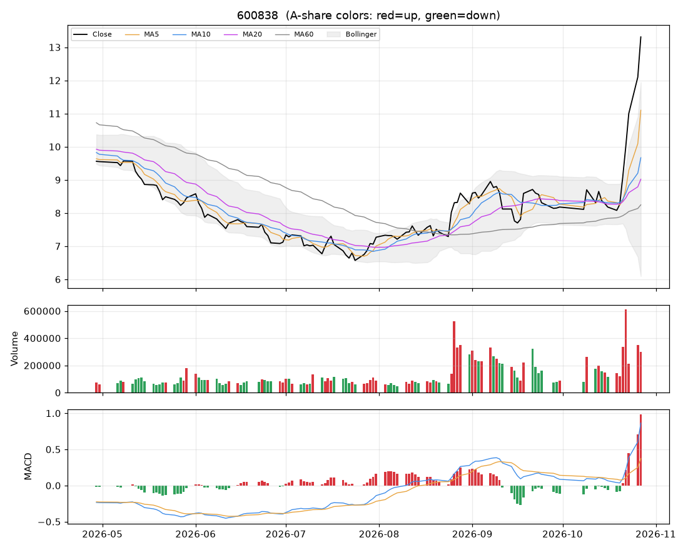

# 个股分析:上海九百(600838)  2026-10-27

> 规则化分析,仅供个人研究参考,不构成投资建议;不覆盖基本面/公告/解禁/减持等事件,操作前请自行核对。

数据来源:实时拉取(新浪);行业:商业百货;最新价 **13.31**(+10.00%)

## 结论速览

**综合评分 60/100 → 倾向「中性偏多」**

| 维度 | 得分 | 权重 | 加减分项/说明 |
|---|---|---|---|
| 模型(全市场分位) | 34 | 35% | 第843/1219名 |
| 趋势(均线/MACD/RSI) | 82 | 25% | 收盘>MA20(+10)、收盘>MA60(+10)、MA20向上(+8)、MA5>MA10>MA20多头排列(+10)、DIF>DEA(+6)、DIF在零轴上(+4)、RSI>80过热(-8)、乖离MA20>15%(-8) |
| 量价 | 66 | 20% | 近10日上涨日量能占优(+10)、5日资金代理净流入(+6) |
| 环境(板块/大盘/相对强弱) | 71 | 20% | 所属板块强度89(+19.6)、市场情绪28(-9)、20日相对沪深300 +61.8%(+10) |

- ⚠ 今日涨停:次日开盘大概率高开,难以按理想价买入,不追;已持仓者看次日是否放量炸板
- ⚠ 短线过热(乖离MA20 +47.6%,RSI 85):不追高,等回踩

## 一、模型视角

- 模型分位 **34%**(LightGBM 55% / ICIR线性 4%),在 1219 只可交易股票中排第 **843**。目标是预测未来 2 日的截面相对强弱,不是预测涨跌绝对值。

推高得分的因子 Top5:

| 因子 | 该股标准分(z) | LightGBM SHAP 贡献 |
|---|---|---|
| MA20乖离 | +3.56 | +0.0150 |
| OBV斜率 | +1.51 | +0.0065 |
| 20日动量 | +3.68 | +0.0046 |
| 20日波动率 | +2.37 | +0.0021 |
| ATR波幅 | +0.51 | +0.0019 |

拉低得分的因子 Top5:

| 因子 | 该股标准分(z) | LightGBM SHAP 贡献 |
|---|---|---|
| 换手放大 | +2.33 | -0.0131 |
| 20日最大单日涨幅 | +1.66 | -0.0032 |
| 上影线 | -1.33 | -0.0032 |
| 收盘位置 | +1.56 | -0.0026 |
| 60日动量(跳过近5日) | +1.04 | -0.0023 |

说明:z 为该因子在全市场(行业中性后)的标准分;SHAP 为该因子对模型打分的边际贡献,正值=推高。

## 二、技术面

| 指标 | 数值 | 解读 |
|---|---|---|
| 均线 MA5/10/20/60 | 11.10 / 9.67 / 9.02 / 8.25 | 多头排列(短期强) |
| MA20 斜率(5日) | +9.02% | 向上 |
| 收盘 vs MA20 乖离 | +47.6% | 乖离过大(>15%),回落风险 |
| MACD DIF/DEA/柱 | 0.864 / 0.374 / 0.981 | 零轴上、DIF在DEA上方 |
| KDJ K/D/J | 91 / 77 / 119 | 超买(J>100) |
| RSI14 | 85 | 过热(>80) |
| 布林 %B / 带宽分位 | 1.23 / 100% | 贴近上轨、带宽扩张(波动放大) |
| ATR14 | 0.68(5.1%) | 日均波幅,用于止损/目标 |
| 今日K线 | +10.00% | 大阳线(收近高位)、向上跳空缺口 |

## 三、量价分析

| 指标 | 数值 | 解读 |
|---|---|---|
| 量比(今/前5日均) | 0.92 | 量价关系平淡 |
| 成交额 / 20日均 | 2.12x | 放量 |
| 换手率120日分位 | 92% | 交投活跃 |
| 近10日 上涨日/下跌日均量 | 2.30 | 上涨放量占优 |
| OBV 与价格(20日) | 价格分位100% / OBV分位100% | 无明显背离 |
| 资金代理 5日/20日 | +0.88 / +0.42 | 偏流入 |
| 收盘 vs 20日量加权均价 | +39.5% | 在成本区上方 |
| 特殊量价信号 | 无 |  |

## 四、相对强弱与环境

|  | 20日 | 60日 |
|---|---|---|
| 该股 | +52.81% | +97.19% |
| 沪深300 | -8.96% | -11.74% |
| 所属板块(商业百货,等权) | -4.76% | - |

- 板块强度分 89,排第 1/49;今日 -0.88%,5日 +0.72%,拥挤度 89%,上涨占比 12%
- 板块归因:板块等权下跌0.88%;缩量(0.4倍);普跌(上涨占比仅12%)。领跌:我爱我家(-2.6%)、深圳华强(-4.8%)、天音控股(-5.0%)
- 大盘:情绪温度 28(偏冷);整体仓位参考 10%~20%

## 五、该股历史同类信号表现(近3年,持有2日,T+1开盘买入)

| 信号 | 当前触发 | 次数 | 平均 | 中位数 | 胜率 | 样本 |
|---|---|---|---|---|---|---|
| MACD金叉 | 否 | 36 | +0.47% | -0.17% | 36% | 可参考 |
| 放量突破20日高 | 否 | 16 | +3.19% | +1.58% | 69% | 可参考 |
| 缩量回踩MA20 | 否 | 44 | +1.42% | -0.24% | 48% | 可参考 |
| RSI超卖(<30) | 否 | 23 | +0.25% | -0.43% | 48% | 可参考 |
| 布林下轨反弹 | 否 | 18 | +1.37% | +0.13% | 50% | 可参考 |
| 均线刚形成多头排列 | 否 | 27 | +1.28% | -0.35% | 44% | 可参考 |
| 放量跌破20日低 | 否 | 6 | +2.33% | +2.12% | 67% | 不足(<10) |

该股无条件持有2日平均收益 +0.48%。次数<10 的统计基本不可靠;信号过去有效不代表以后有效,仅作参考。

## 六、操作参考

**当前倾向:中性偏多(综合 60)**

### 价位(基于 ATR 与近期结构)

| 项目 | 数值 |
|---|---|
| 最新价 | 13.31 |
| 下方支撑 | 9.02 |
| 上方压力 1 / 2 | 无(阶段新高) |
| 建议止损价 | 12.29(距现价 7.6%) |
| 目标 1 / 目标 2 | 14.66 / 16.02 |
| 盈亏比(到目标1) | 1.3 |
| 回踩介入区 | 8.97~9.72 |

- ⚠ 到目标1的盈亏比仅 1.3(<1.5),性价比一般,宁可等更好的位置。

### 空仓者

- 今日涨停,次日开盘价不可控,不追。若次日高开回落、缩量企稳在 8.97~9.72 再评估;连续一字板则根本买不到。

### 已持仓者

- 可持有但不加仓;收盘跌破 MA20 且放量,或触及止损价,先减仓一半。
- 反弹到 14.66 附近若放量滞涨(上影线变长),逢高减仓。
- 次日若高开后放量炸板/冲高回落,先减 1/3~1/2;封单稳固可继续持有,止损上移到今日最低价 12.78 附近。

### 仓位

- 单票仓位上限约 **6%** 总资金(= min(档位上限 15%, 单笔风险1%÷止损幅度7.6%=13%) × 市场情绪系数 0.46)。今日涨/跌停,新建仓位建议为 0,上面数字仅供后续参考
- 分批建仓,首笔不超过上限的一半;亏损时不加仓摊平。

### 失效条件(出现任一条,以上判断作废)

- 收盘跌破止损价 12.29
- 放量(量比>1.5)跌破20日低点 7.95
- 所属板块转弱(强度分掉出前50%)且个股缩量冲高回落
- 出现公告类利空/业绩预亏/减持/解禁等基本面事件(本程序未覆盖,需自行核对)

### 交易规则提醒

- T+1:今日买入明日才能卖;涨跌停幅度 ±10%;止损位只能在下一交易日起执行,跳空时成交价会更差。
- 本分析不含基本面、业绩预告、公告、解禁/减持、融资融券与龙虎榜,请在下单前自行核对。
