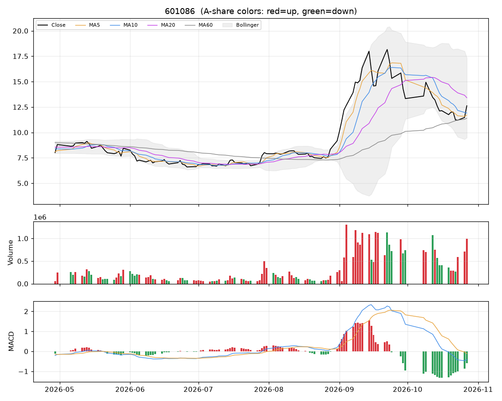

# 个股分析:国芳集团(601086)  2026-10-27

> 规则化分析,仅供个人研究参考,不构成投资建议;不覆盖基本面/公告/解禁/减持等事件,操作前请自行核对。

数据来源:实时拉取(新浪);行业:未知;最新价 **12.62**(+10.03%)

## 结论速览

**综合评分 30/100 → 倾向「偏空」**

| 维度 | 得分 | 权重 | 加减分项/说明 |
|---|---|---|---|
| 模型(全市场分位) | 14 | 35% | 第1105/1219名 |
| 趋势(均线/MACD/RSI) | 22 | 25% | 收盘<MA20(-10)、收盘>MA60(+10)、MA20向下(-8)、MA5<MA10<MA20空头排列(-10)、DIF<DEA(-6)、DIF在零轴下(-4) |
| 量价 | 68 | 20% | 价涨量增(+12)、5日资金代理净流入(+6) |
| 环境(板块/大盘/相对强弱) | 31 | 20% | 市场情绪28(-9)、20日相对沪深300 -19.6%(-9.8) |

- ⚠ 今日涨停:次日开盘大概率高开,难以按理想价买入,不追;已持仓者看次日是否放量炸板

## 一、模型视角

- 模型分位 **14%**(LightGBM 18% / ICIR线性 8%),在 1219 只可交易股票中排第 **1105**。目标是预测未来 2 日的截面相对强弱,不是预测涨跌绝对值。

推高得分的因子 Top5:

| 因子 | 该股标准分(z) | LightGBM SHAP 贡献 |
|---|---|---|
| Amihud非流动性 | -1.19 | +0.0046 |
| 1日反转 | -4.29 | +0.0038 |
| 换手放大 | -0.58 | +0.0032 |
| 量价相关 | +0.15 | +0.0030 |
| 成交额规模 | +1.59 | +0.0013 |

拉低得分的因子 Top5:

| 因子 | 该股标准分(z) | LightGBM SHAP 贡献 |
|---|---|---|
| 20日换手 | +3.11 | -0.0081 |
| 上影线 | -1.39 | -0.0051 |
| 5日资金代理 | +1.82 | -0.0050 |
| 收盘位置 | +2.13 | -0.0046 |
| RSI14 | +0.82 | -0.0043 |

说明:z 为该因子在全市场(行业中性后)的标准分;SHAP 为该因子对模型打分的边际贡献,正值=推高。

## 二、技术面

| 指标 | 数值 | 解读 |
|---|---|---|
| 均线 MA5/10/20/60 | 11.71 / 11.91 / 13.41 / 11.39 | 空头排列(短期弱) |
| MA20 斜率(5日) | -7.12% | 向下 |
| 收盘 vs MA20 乖离 | -5.9% | 正常区间 |
| MACD DIF/DEA/柱 | -0.412 / -0.112 / -0.599 | 零轴下、DIF在DEA下方 |
| KDJ K/D/J | 45 / 24 / 87 | 中性 |
| RSI14 | 49 | 中性 |
| 布林 %B / 带宽分位 | 0.40 / 83% | 带内运行、带宽扩张(波动放大) |
| ATR14 | 1.04(8.3%) | 日均波幅,用于止损/目标 |
| 今日K线 | +10.03% | 大阳线(收近高位) |

## 三、量价分析

| 指标 | 数值 | 解读 |
|---|---|---|
| 量比(今/前5日均) | 2.32 | 价涨量增(健康) |
| 成交额 / 20日均 | 1.30x | 正常 |
| 换手率120日分位 | 93% | 交投活跃 |
| 近10日 上涨日/下跌日均量 | 1.23 | 均衡 |
| OBV 与价格(20日) | 价格分位50% / OBV分位60% | 无明显背离 |
| 资金代理 5日/20日 | +0.17 / -0.16 | 偏流入 |
| 收盘 vs 20日量加权均价 | -9.4% | 在成本区下方 |
| 特殊量价信号 | 无 |  |

## 四、相对强弱与环境

|  | 20日 | 60日 |
|---|---|---|
| 该股 | -28.58% | +83.70% |
| 沪深300 | -8.96% | -11.74% |

- 板块信息不可用(不在股票池或行业未知)
- 大盘:情绪温度 28(偏冷);整体仓位参考 10%~20%

## 五、该股历史同类信号表现(近3年,持有2日,T+1开盘买入)

| 信号 | 当前触发 | 次数 | 平均 | 中位数 | 胜率 | 样本 |
|---|---|---|---|---|---|---|
| MACD金叉 | 否 | 30 | -0.65% | -0.51% | 43% | 可参考 |
| 放量突破20日高 | 否 | 19 | +1.47% | -1.68% | 47% | 可参考 |
| 缩量回踩MA20 | 否 | 35 | +0.67% | -0.89% | 46% | 可参考 |
| RSI超卖(<30) | 否 | 10 | +0.36% | +0.93% | 70% | 可参考 |
| 布林下轨反弹 | 否 | 12 | +1.34% | +0.97% | 83% | 可参考 |
| 均线刚形成多头排列 | 否 | 29 | +0.00% | -0.11% | 45% | 可参考 |
| 放量跌破20日低 | 否 | 5 | +4.19% | +3.90% | 80% | 不足(<10) |

该股无条件持有2日平均收益 +0.73%。次数<10 的统计基本不可靠;信号过去有效不代表以后有效,仅作参考。

## 六、操作参考

**当前倾向:偏空(综合 30)**

### 价位(基于 ATR 与近期结构)

| 项目 | 数值 |
|---|---|
| 最新价 | 12.62 |
| 下方支撑 | 11.39 |
| 上方压力 1 / 2 | 15.53 / 17.99 |
| 建议止损价 | 11.28(距现价 10.7%) |
| 目标 1 / 目标 2 | 15.53 / 17.99 |
| 盈亏比(到目标1) | 2.2 |
| 回踩介入区 | - |

### 空仓者

- 今日涨停,次日开盘价不可控,不追。若次日高开回落、缩量企稳在 MA10 附近 再评估;连续一字板则根本买不到。

### 已持仓者

- 反弹至 MA5/MA10(11.71/11.91)或压力位(15.53)时减仓/清仓;止损价不可下移。
- 次日若高开后放量炸板/冲高回落,先减 1/3~1/2;封单稳固可继续持有,止损上移到今日最低价 11.03 附近。

### 仓位

- 单票仓位上限约 **0%** 总资金(= min(档位上限 0%, 单笔风险1%÷止损幅度10.7%=9%) × 市场情绪系数 0.46)。今日涨/跌停,新建仓位建议为 0,上面数字仅供后续参考
- 分批建仓,首笔不超过上限的一半;亏损时不加仓摊平。

### 失效条件(出现任一条,以上判断作废)

- 收盘跌破止损价 11.28
- 放量(量比>1.5)跌破20日低点 10.63
- 所属板块转弱(强度分掉出前50%)且个股缩量冲高回落
- 出现公告类利空/业绩预亏/减持/解禁等基本面事件(本程序未覆盖,需自行核对)

### 交易规则提醒

- T+1:今日买入明日才能卖;涨跌停幅度 ±10%;止损位只能在下一交易日起执行,跳空时成交价会更差。
- 本分析不含基本面、业绩预告、公告、解禁/减持、融资融券与龙虎榜,请在下单前自行核对。
