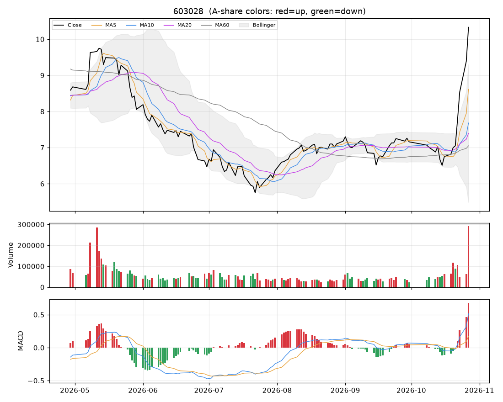

# 个股分析:赛福天(603028)  2026-10-27

> 规则化分析,仅供个人研究参考,不构成投资建议;不覆盖基本面/公告/解禁/减持等事件,操作前请自行核对。

数据来源:实时拉取(新浪);行业:未知;最新价 **10.33**(+10.01%)

## 结论速览

**综合评分 72/100 → 倾向「偏多」**

| 维度 | 得分 | 权重 | 加减分项/说明 |
|---|---|---|---|
| 模型(全市场分位) | 无 | 35% | 近20日日均成交额 0.53 亿 < 门槛 1.0 亿 |
| 趋势(均线/MACD/RSI) | 82 | 25% | 收盘>MA20(+10)、收盘>MA60(+10)、MA20向上(+8)、MA5>MA10>MA20多头排列(+10)、DIF>DEA(+6)、DIF在零轴上(+4)、RSI>80过热(-8)、乖离MA20>15%(-8) |
| 量价 | 82 | 20% | 价涨量增(+12)、近10日上涨日量能占优(+10)、放量突破20日高(+10) |
| 环境(板块/大盘/相对强弱) | 51 | 20% | 市场情绪28(-9)、20日相对沪深300 +55.5%(+10) |

- ⚠ 今日涨停:次日开盘大概率高开,难以按理想价买入,不追;已持仓者看次日是否放量炸板
- ⚠ 短线过热(乖离MA20 +39.7%,RSI 86):不追高,等回踩

## 一、模型视角

- 模型未对该股打分:近20日日均成交额 0.53 亿 < 门槛 1.0 亿。
- 综合评分已自动把模型权重分摊给其余三个维度。

## 二、技术面

| 指标 | 数值 | 解读 |
|---|---|---|
| 均线 MA5/10/20/60 | 8.61 / 7.68 / 7.40 / 7.05 | 多头排列(短期强) |
| MA20 斜率(5日) | +6.68% | 向上 |
| 收盘 vs MA20 乖离 | +39.7% | 乖离过大(>15%),回落风险 |
| MACD DIF/DEA/柱 | 0.513 / 0.174 / 0.679 | 零轴上、DIF在DEA上方 |
| KDJ K/D/J | 90 / 77 / 118 | 超买(J>100) |
| RSI14 | 86 | 过热(>80) |
| 布林 %B / 带宽分位 | 1.27 / 100% | 贴近上轨、带宽扩张(波动放大) |
| ATR14 | 0.53(5.2%) | 日均波幅,用于止损/目标 |
| 今日K线 | +10.01% | 大阳线(收近高位)、十字星(多空僵持)、向上跳空缺口 |

## 三、量价分析

| 指标 | 数值 | 解读 |
|---|---|---|
| 量比(今/前5日均) | 3.44 | 价涨量增(健康) |
| 成交额 / 20日均 | 5.70x | 放量 |
| 换手率120日分位 | 100% | 交投活跃 |
| 近10日 上涨日/下跌日均量 | 2.08 | 上涨放量占优 |
| OBV 与价格(20日) | 价格分位100% / OBV分位100% | 无明显背离 |
| 资金代理 5日/20日 | +0.10 / +0.07 | 中性(CLV估算,非真实主力资金) |
| 收盘 vs 20日量加权均价 | +30.1% | 在成本区上方 |
| 特殊量价信号 | 放量突破20日高、60日天量 |  |

## 四、相对强弱与环境

|  | 20日 | 60日 |
|---|---|---|
| 该股 | +46.52% | +68.79% |
| 沪深300 | -8.96% | -11.74% |

- 板块信息不可用(不在股票池或行业未知)
- 大盘:情绪温度 28(偏冷);整体仓位参考 10%~20%

## 五、该股历史同类信号表现(近3年,持有2日,T+1开盘买入)

| 信号 | 当前触发 | 次数 | 平均 | 中位数 | 胜率 | 样本 |
|---|---|---|---|---|---|---|
| MACD金叉 | 否 | 30 | +0.31% | -0.37% | 47% | 可参考 |
| 放量突破20日高 | 是 | 11 | -1.79% | -1.15% | 45% | 可参考 |
| 缩量回踩MA20 | 否 | 32 | +0.17% | +0.55% | 53% | 可参考 |
| RSI超卖(<30) | 否 | 39 | -0.92% | -0.08% | 49% | 可参考 |
| 布林下轨反弹 | 否 | 19 | +1.02% | +0.45% | 53% | 可参考 |
| 均线刚形成多头排列 | 否 | 30 | +0.51% | +0.74% | 63% | 可参考 |
| 放量跌破20日低 | 否 | 10 | -0.16% | +1.33% | 60% | 可参考 |

该股无条件持有2日平均收益 -0.08%。次数<10 的统计基本不可靠;信号过去有效不代表以后有效,仅作参考。

## 六、操作参考

**当前倾向:偏多(综合 72)**

### 价位(基于 ATR 与近期结构)

| 项目 | 数值 |
|---|---|
| 最新价 | 10.33 |
| 下方支撑 | 7.40 |
| 上方压力 1 / 2 | 无(阶段新高) |
| 建议止损价 | 9.53(距现价 7.8%) |
| 目标 1 / 目标 2 | 11.40 / 12.47 |
| 盈亏比(到目标1) | 1.3 |
| 回踩介入区 | 7.36~7.72 |

- ⚠ 到目标1的盈亏比仅 1.3(<1.5),性价比一般,宁可等更好的位置。

### 空仓者

- 今日涨停,次日开盘价不可控,不追。若次日高开回落、缩量企稳在 7.36~7.72 再评估;连续一字板则根本买不到。

### 已持仓者

- 继续持有;止损位上移到下方给出的止损价,不随意下调。
- 到第一目标 11.40 先减 1/3~1/2,剩余用 MA10 或「最高价-2×ATR」做移动止盈。
- 次日若高开后放量炸板/冲高回落,先减 1/3~1/2;封单稳固可继续持有,止损上移到今日最低价 10.33 附近。

### 仓位

- 单票仓位上限约 **6%** 总资金(= min(档位上限 25%, 单笔风险1%÷止损幅度7.8%=13%) × 市场情绪系数 0.46)。今日涨/跌停,新建仓位建议为 0,上面数字仅供后续参考
- 分批建仓,首笔不超过上限的一半;亏损时不加仓摊平。

### 失效条件(出现任一条,以上判断作废)

- 收盘跌破止损价 9.53
- 放量(量比>1.5)跌破20日低点 6.36
- 所属板块转弱(强度分掉出前50%)且个股缩量冲高回落
- 出现公告类利空/业绩预亏/减持/解禁等基本面事件(本程序未覆盖,需自行核对)

### 交易规则提醒

- T+1:今日买入明日才能卖;涨跌停幅度 ±10%;止损位只能在下一交易日起执行,跳空时成交价会更差。
- 本分析不含基本面、业绩预告、公告、解禁/减持、融资融券与龙虎榜,请在下单前自行核对。
