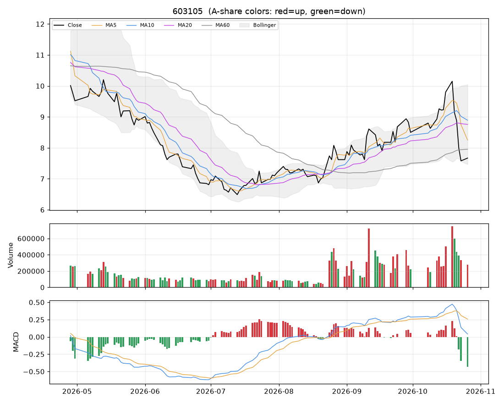

# 个股分析:603105(603105)  2026-10-26

> 规则化分析,仅供个人研究参考,不构成投资建议;不覆盖基本面/公告/解禁/减持等事件,操作前请自行核对。

数据来源:实时拉取(新浪);行业:未知;最新价 **7.67**(+1.19%)

## 结论速览

**综合评分 53/100 → 倾向「中性」**

| 维度 | 得分 | 权重 | 加减分项/说明 |
|---|---|---|---|
| 模型(全市场分位) | 73 | 35% | 第161/758名 |
| 趋势(均线/MACD/RSI) | 31 | 25% | 收盘<MA20(-10)、收盘<MA60(-10)、MA20向上(+8)、DIF<DEA(-6)、DIF在零轴上(+4)、近3日MACD死叉(-5) |
| 量价 | 49 | 20% | 价涨量缩(-3)、OBV底背离(+8)、5日资金代理净流出(-6) |
| 环境(板块/大盘/相对强弱) | 50 | 20% | 市场情绪46(-1.6)、20日相对沪深300 +2.7%(+1.4) |

## 一、模型视角

- 模型分位 **73%**(LightGBM 98% / ICIR线性 35%),在 758 只可交易股票中排第 **161**。目标是预测未来 5 日的截面相对强弱,不是预测涨跌绝对值。

推高得分的因子 Top5:

| 因子 | 该股标准分(z) | LightGBM SHAP 贡献 |
|---|---|---|
| 20日换手 | +3.13 | +0.0506 |
| 5日资金代理 | -2.03 | +0.0220 |
| 60日动量(跳过近5日) | +4.40 | +0.0192 |
| Amihud非流动性 | +1.51 | +0.0109 |
| 成交额规模 | -0.36 | +0.0031 |

拉低得分的因子 Top5:

| 因子 | 该股标准分(z) | LightGBM SHAP 贡献 |
|---|---|---|
| 20日最大单日涨幅 | +0.46 | -0.0189 |
| 20日波动率 | +2.09 | -0.0114 |
| ATR波幅 | +2.36 | -0.0089 |
| 5日动量 | -3.56 | -0.0043 |
| 60日区间位置 | -0.27 | -0.0033 |

说明:z 为该因子在全市场(行业中性后)的标准分;SHAP 为该因子对模型打分的边际贡献,正值=推高。

## 二、技术面

| 指标 | 数值 | 解读 |
|---|---|---|
| 均线 MA5/10/20/60 | 8.25 / 8.89 / 8.76 / 7.95 | 均线交织(方向不明) |
| MA20 斜率(5日) | +0.32% | 向上 |
| 收盘 vs MA20 乖离 | -12.4% | 正常区间 |
| MACD DIF/DEA/柱 | 0.041 / 0.257 / -0.431 | 零轴上、近3日死叉 |
| KDJ K/D/J | 20 / 36 / -10 | 超卖(J<0) |
| RSI14 | 40 | 中性 |
| 布林 %B / 带宽分位 | 0.08 / 89% | 贴近下轨、带宽扩张(波动放大) |
| ATR14 | 0.69(9.0%) | 日均波幅,用于止损/目标 |
| 今日K线 | +1.19% | 无特殊形态 |

## 三、量价分析

| 指标 | 数值 | 解读 |
|---|---|---|
| 量比(今/前5日均) | 0.55 | 价涨量缩(动能不足) |
| 成交额 / 20日均 | 0.66x | 缩量 |
| 换手率120日分位 | 80% | 正常 |
| 近10日 上涨日/下跌日均量 | 1.08 | 均衡 |
| OBV 与价格(20日) | 价格分位10% / OBV分位65% | 底背离(价格低位、量能转强) |
| 资金代理 5日/20日 | -0.36 / +0.13 | 偏流出 |
| 收盘 vs 20日量加权均价 | -13.8% | 在成本区下方 |
| 特殊量价信号 | 无 |  |

## 四、相对强弱与环境

|  | 20日 | 60日 |
|---|---|---|
| 该股 | -6.23% | +11.64% |
| 沪深300 | -8.96% | -11.74% |

- 板块信息不可用(不在股票池或行业未知)
- 大盘:情绪温度 46(震荡/中性);整体仓位参考 30%~40%

## 五、该股历史同类信号表现(近3年,持有5日,T+1开盘买入)

| 信号 | 当前触发 | 次数 | 平均 | 中位数 | 胜率 | 样本 |
|---|---|---|---|---|---|---|
| MACD金叉 | 否 | 27 | -0.60% | +0.59% | 52% | 可参考 |
| 放量突破20日高 | 否 | 19 | -2.04% | -1.68% | 26% | 可参考 |
| 缩量回踩MA20 | 否 | 22 | -0.76% | -0.30% | 41% | 可参考 |
| RSI超卖(<30) | 否 | 9 | -2.11% | -2.20% | 33% | 不足(<10) |
| 布林下轨反弹 | 否 | 12 | -2.86% | -1.80% | 25% | 可参考 |
| 均线刚形成多头排列 | 否 | 31 | -1.07% | -0.28% | 45% | 可参考 |
| 放量跌破20日低 | 否 | 6 | +2.01% | +2.37% | 67% | 不足(<10) |

该股无条件持有5日平均收益 +0.06%。次数<10 的统计基本不可靠;信号过去有效不代表以后有效,仅作参考。

## 六、操作参考

**当前倾向:中性(综合 53)**

### 价位(基于 ATR 与近期结构)

| 项目 | 数值 |
|---|---|
| 最新价 | 7.67 |
| 下方支撑 | 7.58 |
| 上方压力 1 / 2 | 8.18 / 9.08 |
| 建议止损价 | 6.98(距现价 9.0%) |
| 目标 1 / 目标 2 | 9.06 / 10.44 |
| 盈亏比(到目标1) | 2.0 |
| 回踩介入区 | - |

### 空仓者

- 观望,等方向选择:
- 向上:放量站上 8.18 再考虑;向下:跌破 6.98 则回避。

### 已持仓者

- 不加仓。跌破止损价无条件执行;反弹到压力位附近(8.18)可减仓降风险。

### 仓位

- 单票仓位上限约 **6%** 总资金(= min(档位上限 8%, 单笔风险1%÷止损幅度9.0%=11%) × 市场情绪系数 0.77)
- 分批建仓,首笔不超过上限的一半;亏损时不加仓摊平。

### 失效条件(出现任一条,以上判断作废)

- 收盘跌破止损价 6.98
- 放量(量比>1.5)跌破20日低点 7.22
- 所属板块转弱(强度分掉出前50%)且个股缩量冲高回落
- 出现公告类利空/业绩预亏/减持/解禁等基本面事件(本程序未覆盖,需自行核对)

### 交易规则提醒

- T+1:今日买入明日才能卖;涨跌停幅度 ±10%;止损位只能在下一交易日起执行,跳空时成交价会更差。
- 本分析不含基本面、业绩预告、公告、解禁/减持、融资融券与龙虎榜,请在下单前自行核对。
