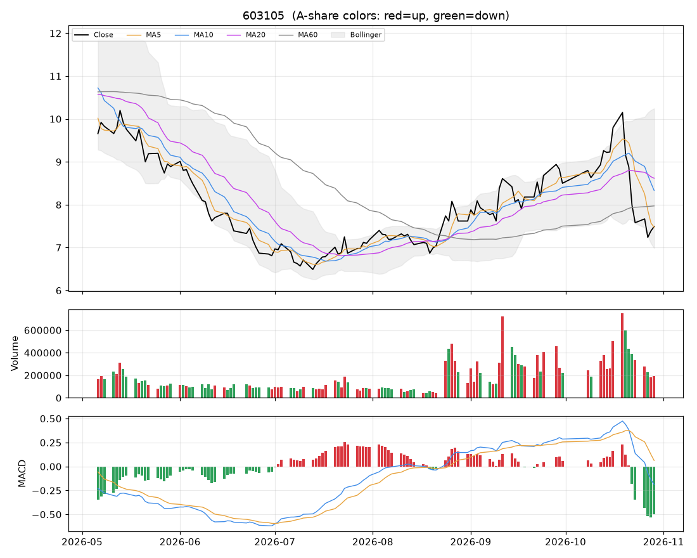

# 个股分析:芯能科技(603105)  2026-10-29

> 规则化分析,仅供个人研究参考,不构成投资建议;不覆盖基本面/公告/解禁/减持等事件,操作前请自行核对。

数据来源:实时拉取(新浪);行业:未知;最新价 **7.49**(+1.35%)

## 结论速览

**综合评分 24/100 → 倾向「偏空」**

| 维度 | 得分 | 权重 | 加减分项/说明 |
|---|---|---|---|
| 模型(全市场分位) | 14 | 35% | 第2564/2817名 |
| 趋势(均线/MACD/RSI) | 2 | 25% | 收盘<MA20(-10)、收盘<MA60(-10)、MA20向下(-8)、MA5<MA10<MA20空头排列(-10)、DIF<DEA(-6)、DIF在零轴下(-4) |
| 量价 | 53 | 20% | 价涨量缩(-3)、5日资金代理净流入(+6) |
| 环境(板块/大盘/相对强弱) | 41 | 20% | 市场情绪25(-10.1)、20日相对沪深300 +2.0%(+1) |

- ⚠ 市场情绪处于冰点,综合分已封顶 55
- ⚠ 价格在MA60下方且MA20向下,综合分封顶 52(下降趋势中不抄底)

## 一、模型视角

- 模型分位 **14%**(LightGBM 9% / ICIR线性 23%),在 2817 只可交易股票中排第 **2564**。目标是预测未来 2 日的截面相对强弱,不是预测涨跌绝对值。

推高得分的因子 Top5:

| 因子 | 该股标准分(z) | LightGBM SHAP 贡献 |
|---|---|---|
| 换手放大 | -1.23 | +0.0015 |
| 上影线 | +0.47 | +0.0011 |
| 20日最大单日涨幅 | +0.03 | +0.0005 |
| 量比 | -0.74 | +0.0005 |
| OBV斜率 | +1.47 | +0.0001 |

拉低得分的因子 Top5:

| 因子 | 该股标准分(z) | LightGBM SHAP 贡献 |
|---|---|---|
| ATR波幅 | +1.53 | -0.0184 |
| 收盘位置 | +1.83 | -0.0070 |
| 1日反转 | -1.48 | -0.0060 |
| MA20乖离 | -0.85 | -0.0057 |
| 20日换手 | +1.81 | -0.0037 |

说明:z 为该因子在全市场(行业中性后)的标准分;SHAP 为该因子对模型打分的边际贡献,正值=推高。

## 二、技术面

| 指标 | 数值 | 解读 |
|---|---|---|
| 均线 MA5/10/20/60 | 7.47 / 8.33 / 8.62 / 7.97 | 空头排列(短期弱) |
| MA20 斜率(5日) | -2.06% | 向下 |
| 收盘 vs MA20 乖离 | -13.1% | 正常区间 |
| MACD DIF/DEA/柱 | -0.188 / 0.063 / -0.501 | 零轴下、DIF在DEA下方 |
| KDJ K/D/J | 11 / 19 / -5 | 超卖(J<0) |
| RSI14 | 40 | 中性 |
| 布林 %B / 带宽分位 | 0.15 / 100% | 带内运行、带宽扩张(波动放大) |
| ATR14 | 0.68(9.1%) | 日均波幅,用于止损/目标 |
| 今日K线 | +1.35% | 无特殊形态 |

## 三、量价分析

| 指标 | 数值 | 解读 |
|---|---|---|
| 量比(今/前5日均) | 0.69 | 价涨量缩(动能不足) |
| 成交额 / 20日均 | 0.48x | 缩量 |
| 换手率120日分位 | 68% | 正常 |
| 近10日 上涨日/下跌日均量 | 0.96 | 均衡 |
| OBV 与价格(20日) | 价格分位15% / OBV分位70% | 无明显背离 |
| 资金代理 5日/20日 | +0.22 / +0.12 | 偏流入 |
| 收盘 vs 20日量加权均价 | -15.2% | 在成本区下方 |
| 特殊量价信号 | 无 |  |

## 四、相对强弱与环境

|  | 20日 | 60日 |
|---|---|---|
| 该股 | -8.55% | +5.20% |
| 沪深300 | -10.52% | -12.14% |

- 板块信息不可用(不在股票池或行业未知)
- 大盘:情绪温度 25(冰点/退潮);整体仓位参考 0%~10%(空仓观望为主)

## 五、该股历史同类信号表现(近3年,持有2日,T+1开盘买入)

| 信号 | 当前触发 | 次数 | 平均 | 中位数 | 胜率 | 样本 |
|---|---|---|---|---|---|---|
| MACD金叉 | 否 | 29 | +1.12% | +0.63% | 66% | 可参考 |
| 放量突破20日高 | 否 | 21 | -0.20% | -1.36% | 33% | 可参考 |
| 缩量回踩MA20 | 否 | 32 | -1.26% | -0.54% | 38% | 可参考 |
| RSI超卖(<30) | 否 | 34 | +0.02% | -0.20% | 44% | 可参考 |
| 布林下轨反弹 | 否 | 13 | -0.22% | -0.25% | 46% | 可参考 |
| 均线刚形成多头排列 | 否 | 31 | +0.15% | +0.48% | 55% | 可参考 |
| 放量跌破20日低 | 否 | 6 | -0.96% | -0.48% | 33% | 不足(<10) |

该股无条件持有2日平均收益 +0.07%。次数<10 的统计基本不可靠;信号过去有效不代表以后有效,仅作参考。

## 六、操作参考

**当前倾向:偏空(综合 24)**

### 价位(基于 ATR 与近期结构)

| 项目 | 数值 |
|---|---|
| 最新价 | 7.49 |
| 下方支撑 | 7.14 |
| 上方压力 1 / 2 | 8.18 / 9.08 |
| 建议止损价 | 6.81(距现价 9.1%) |
| 目标 1 / 目标 2 | 8.18 / 10.23 |
| 盈亏比(到目标1) | 1.0 |
| 回踩介入区 | - |

- ⚠ 到目标1的盈亏比仅 1.0(<1.5),性价比一般,宁可等更好的位置。

### 空仓者

- 回避,不抄底。等重新站上 MA20(8.62)并放量后再评估。

### 已持仓者

- 反弹至 MA5/MA10(7.47/8.33)或压力位(8.18)时减仓/清仓;止损价不可下移。

### 仓位

- 单票仓位上限约 **0%** 总资金(= min(档位上限 0%, 单笔风险1%÷止损幅度9.1%=11%) × 市场情绪系数 0.41)
- 分批建仓,首笔不超过上限的一半;亏损时不加仓摊平。

### 失效条件(出现任一条,以上判断作废)

- 收盘跌破止损价 6.81
- 放量(量比>1.5)跌破20日低点 7.14
- 所属板块转弱(强度分掉出前50%)且个股缩量冲高回落
- 出现公告类利空/业绩预亏/减持/解禁等基本面事件(本程序未覆盖,需自行核对)

### 交易规则提醒

- T+1:今日买入明日才能卖;涨跌停幅度 ±10%;止损位只能在下一交易日起执行,跳空时成交价会更差。
- 本分析不含基本面、业绩预告、公告、解禁/减持、融资融券与龙虎榜,请在下单前自行核对。
